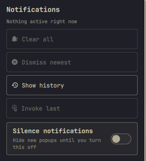

# Notifications menu for Omarchy

A bar widget for [Omarchy](https://omarchy.org) that puts a notification bell
between your other status icons. Click it for a dropdown to clear, dismiss,
replay history, invoke the last toast, or silence popups.



## Install

```bash
omarchy plugin add https://github.com/fire1/omarchy-clear-notifications.git --enable
```

Then place it on the bar if it is not already there:

```bash
omarchy bar put fire1.clear-notifications --after omarchy.keyboard-layout
```

## Use

| Input | Action |
| --- | --- |
| Left-click | Open the notifications menu |
| Right-click | Clear all active notifications |
| Middle-click | Toggle silence (do not disturb) |

Menu actions:

- **Clear all** — dismiss every active toast
- **Dismiss newest** — clear only the top notification
- **Show history** — replay recent notifications
- **Invoke last** — run the default action on the newest toast
- **Silence notifications** — hide new popups until turned off

## Options

Open the widget settings (or use `omarchy bar set`) for:

| Setting | Default | Effect |
| --- | --- | --- |
| `replaceStockSilence` | on | Addon: hide Omarchy's DND indicator and route **Toggle → Silence Notifications** to this menu |
| `showSilenceToggle` | on | Show the Silence switch inside the dropdown |

```bash
omarchy bar set fire1.clear-notifications replaceStockSilence true
omarchy bar set fire1.clear-notifications showSilenceToggle true
```

Turning `replaceStockSilence` off restores the stock Silence indicator and menu rows.

## Remove

```bash
omarchy plugin remove fire1.clear-notifications --yes
```

Removal turns the stock Silence controls back on when the addon was enabled.

## Requirements

- Omarchy with the built-in `omarchy.notifications` shell service
- No extra packages

## License

MIT
